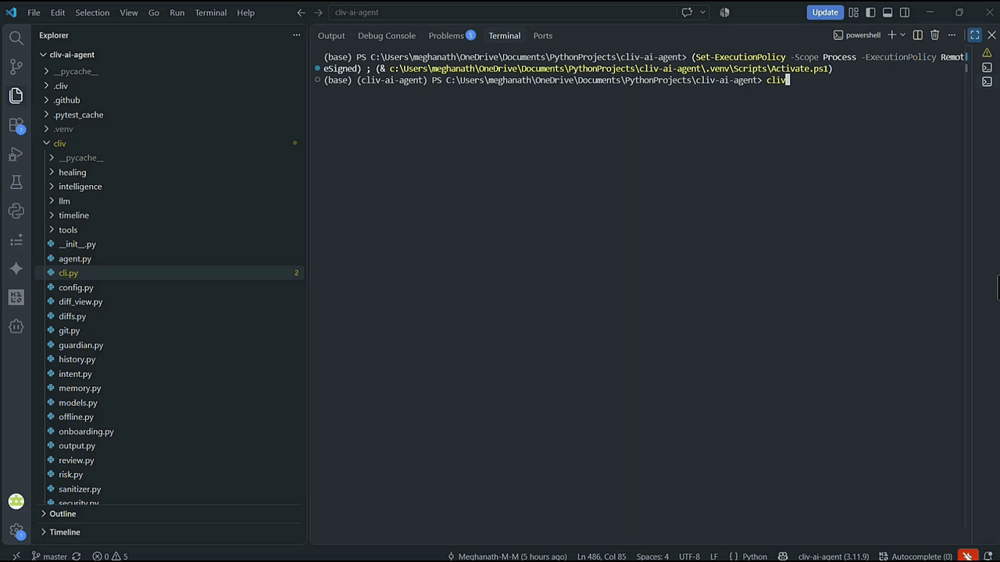

# > cliv_

**Terminal-native intelligence for your local codebase.**

A high-performance, privacy-first terminal AI coding assistant that reads, edits, reviews, tests, and debugs code across single and multi-repo projects. Built for speed, safety, and auditability, it leverages **Groq LPU cloud inference** for sub-second tool calling and **Ollama** for private local execution, featuring automatic network failover, time-travel safety snapshots, long-term memory, and GitHub Actions CI integration.


[](https://www.python.org/)
[](https://opensource.org/licenses/MIT)
[](https://github.com/Meghanath-M-M/cliv-ai-agent)
[](https://console.groq.com/)
[](https://ollama.com/)

---

## ✨ Key Features

- 🌐 **Hybrid Online/Offline Execution** — Use high-speed cloud models via Groq (e.g. `openai/gpt-oss-120b`, `qwen/qwen3.8-27b`) or private local execution with Ollama (e.g. `llama3.1:8b`). Cliv checks connectivity at startup and between turns, gracefully degrading mid-session to Ollama if network drops.

- 🎯 **Interactive Model Switcher (`/model`)** — Easily switch models inside the interactive REPL with keyboard navigation (`↑`/`↓` or `j`/`k`). A live preview card shows hardware specs, parameter size, provider, and direct tool-calling readiness in real time. Press `Enter` to switch, or `q`/`Esc` to cancel.

- ⚡ **Live Thinking & Tool Activity Indicators** — Real-time animated status spinners distinguish LLM reasoning (`Thinking (<model>)...`), tool execution (`Running <tools>...`), offline processing, and self-healing. Completion pills (`⚡ Tool <name> completed`) provide clear feedback on agent operations.

- 🚀 **Automated Project Onboarding (`cliv onboard`)** — Generate comprehensive architectural orientation guides from codebase DNA, git history, detected environments (Python, Node, Rust, Go), test runners, and team conventions. View in terminal, export to `ONBOARDING.md` (`cliv onboard --save`), or dump structured JSON.

- 🛡️ **CI/CD Code Review & Secret Detection (`cliv review`)** — Automated static code review for pull requests and local working trees. Detects hardcoded API keys/credentials, blocks unsafe calls (`eval`, `exec`), validates syntax via AST, runs test suites, formats GitHub Actions PR comments (`--format github`), and auto-generates workflow files (`cliv review --init-ci`).

- 🗂️ **Multi-Repo Workspace Support (`cliv workspace`)** — Link, manage, and search across multiple project repositories simultaneously with strict path-boundary security enforcement.

- 🧠 **Agent Long-Term Memory & Conventions (`cliv memory`)** — Persistent project conventions and user preferences stored in local SQLite and synchronized with `CLIV.md`. Use natural language tools (`remember` and `recall`) or `/memory` to manage team guidelines.

- ⚡ **Parallel Tool Execution** — Independent read-only tools (e.g. scanning multiple directories, reading files, searching RAG embeddings) are automatically batched and executed concurrently via thread pooling.

- 🧩 **3-Tier Tool Plugin System (`cliv tools`)** — Extend the agent with custom Python tools without modifying the core codebase. Automatically discovers tools from built-in directories, user global plugins (`~/.config/cliv/plugins/`), and project-local plugins (`<project>/.cliv/plugins/`). Scaffold new tools instantly with `cliv tools scaffold <name>`.

- ⏪ **Safety Snapshots & Time-Travel Undo (`cliv undo`)** — Automatic pre-write file snapshots captured before any file modification or deletion. Inspect diffs and restore previous project states instantly with conflict detection.

- 🧬 **Project DNA & Visual Dependency Explorer (`cliv dna`, `cliv graph`)** — In-depth architectural analysis extracting classes, functions, circular dependencies, and component topologies with interactive TUI navigation and Mermaid/Graphviz export.

- 🩺 **Self-Healing Test Loop** — Run `cliv "Fix all failing tests"`. Cliv runs pytest, parses failures, formulates targeted repair plans, applies changes through the approval gate, and reruns tests iteratively until the suite passes.

- 🕒 **Development Intelligence Timeline (`cliv timeline`)** — An append-only, secret-redacted SQLite audit log recording every request, tool call, snapshot, test run, and undo operation scoped per repository.

- 📊 **Structured Output Modes (`--json`, `-q`/`--quiet`, `/json`)** — First-class scripting and CI pipeline support. Every major subcommand and single-shot run supports `--json` output, minimal `--quiet` text mode, and interactive REPL `/json` toggling.

- 💸 **Real-Time Cost & Token Telemetry (`cliv cost`)** — Live token counts and estimated USD cost tracking per conversation turn and aggregated across projects and models.

- 💾 **Session Management & Export/Import (`cliv session`, `/export`, `/import`)** — Export active chat sessions to Markdown or JSON, and restore past contexts seamlessly.

---

## 🚀 Quick Start

### 1. Installation

Clone and install dependencies:

```bash
git clone https://github.com/Meghanath-M-M/cliv-ai-agent.git
cd cliv-ai-agent

# Install using uv (recommended for speed)
uv sync --extra all

# Or install with pip
pip install -e ".[all]"
```

*Install extras: `[online]` (Groq), `[offline]` (Ollama + NumPy), `[all]` (both), or `[dev]` (testing suite).*

### 2. Configure Models

* **Online Mode (Groq LPU):** Get a free API key at [console.groq.com](https://console.groq.com/keys) and configure:
  ```bash
  cliv config api-key YOUR_GROQ_API_KEY
  ```
* **Offline Mode (Local Ollama):** Install [Ollama](https://ollama.com/) and pull recommended models:
  ```bash
  ollama pull llama3.1:8b
  ollama pull nomic-embed-text
  ```

### 3. Launch

```bash
# Launch interactive REPL
cliv

# Or run a one-off single-shot command
cliv "Analyze project structure and run pytest"
```

---

## 💻 CLI Subcommand Reference

```bash
cliv [OPTIONS] <COMMAND> [ARGS]...
```

| Command | Description | Example |
|---|---|---|
| `run` *(default)* | Run interactive REPL or single-shot instruction | `cliv "Fix test failures in auth"` |
| `onboard` | Generate architectural orientation guide & setup checklist | `cliv onboard --save` |
| `review` *(check)* | Automated code review, security scanner, and PR formatter | `cliv review --format github` |
| `dna` | Generate Project DNA architecture & component report | `cliv dna --json` |
| `graph` | Visual interactive codebase explorer (TUI / Mermaid export) | `cliv graph --mermaid arch.md` |
| `workspace` *(ws)* | Multi-repo workspace management (list, add, remove, info) | `cliv workspace add ../backend-api` |
| `memory` | Manage long-term agent guidelines and conventions | `cliv memory list --json` |
| `tools` *(plugins)* | List, inspect, or scaffold custom tool plugins | `cliv tools scaffold lint_checker` |
| `models` | Show Ollama and Groq model discovery and health dashboard | `cliv models` |
| `cost` | View session and cumulative project token spend | `cliv cost --json` |
| `rag` | Semantic codebase search and embedding index management | `cliv rag query "authentication flow"` |
| `snapshots` | List safety snapshots captured before file writes | `cliv snapshots list` |
| `undo` | Restore project files from the latest or specified snapshot | `cliv undo` |
| `timeline` | View append-only SQLite development event log | `cliv timeline -n 20` |
| `session` | Manage and export/import conversation sessions | `cliv session export session.md` |
| `git` | Safe Git operations (branch, status, commit) | `cliv git status` |
| `config` | View or configure API keys, models, and permissions | `cliv config set groq_model qwen/qwen3.8-27b` |

### Key Flags & Automation Modes

* `--json` — Machine-readable JSON output on single-shot turns and all subcommands:
  ```bash
  cliv --json "list files in cliv/tools"
  cliv cost --json
  cliv onboard --json
  ```
* `-q`, `--quiet` — Minimal output mode (suppresses banners, ASCII logos, spinners, and dashboards).
* `-y`, `--yes` — Auto-approve tool calls (use with caution in automated CI pipelines).
* `--dry-run` — Preview tool executions and visual diffs without applying any changes.
* `--offline` — Force offline execution with local Ollama models.
* `--permissions` — Restrict capabilities: `--permissions read,write` or `--permissions read`.

---

## ⌨️ Interactive Slash-Command Reference

Inside the interactive REPL (`cliv`), manage active sessions without consuming LLM tokens:

| Slash Command | Description | Example |
|---|---|---|
| `/help` | Display table of available slash commands | `/help` |
| `/model` | **Interactive TUI selector** with `↑`/`↓`/`jk` navigation & specs | `/model` or `/model llama3.1:8b` |
| `/onboard` | Generate orientation report (view or export to file) | `/onboard` or `/onboard save` |
| `/review` | Run automated code review on uncommitted changes or base ref | `/review` or `/review main` |
| `/json` | Toggle structured JSON output mode in REPL | `/json on` or `/json off` |
| `/dna` | Display Project DNA architecture report | `/dna` |
| `/graph` | Launch interactive codebase dependency graph explorer | `/graph` |
| `/workspace` *(ws)* | Manage multi-repo workspaces (list, add, remove, info) | `/workspace add ../core` |
| `/memory` | Add or inspect persistent preferences and conventions | `/memory add "Use pytest fixtures"` |
| `/tools` *(plugins)* | Inspect, scaffold, or reload custom tool plugins | `/tools info edit_file` |
| `/cost` | View live token usage and spend for current project | `/cost` |
| `/diff` | Show Git working tree status and color-coded diff | `/diff` |
| `/undo` | Roll back to last snapshot or specific snapshot ID | `/undo` or `/undo 20261111T...` |
| `/snapshots` | List recent pre-write safety snapshots | `/snapshots 10` |
| `/timeline` | Show recent development timeline events | `/timeline 15` |
| `/rag` | Semantic code search or index rebuild | `/rag query "JWT auth"` |
| `/export` | Export active conversation turn history to Markdown/JSON | `/export session.md` |
| `/import` | Import past session context into active conversation | `/import session.json` |
| `/sessions` | List archived conversation sessions | `/sessions 10` |
| `/branch` | Show or create a Git branch | `/branch feat/new-login` |
| `/commit` | Commit files modified by cliv this session | `/commit "Update auth middleware"` |
| `/permissions` | Inspect or update tool permissions (`read`, `write`, `execute`) | `/permissions read,write` |
| `/clear` | Clear active conversation turn history | `/clear` |
| `/exit` *(quit)* | Exit session | `/exit` |

---

## 🛠️ Built-in Tool Reference

All 22 built-in tools are strictly confined to the project root, governed by Security Guardian policies, and snapshot-backed before mutations:

| Tool Name | Description | Permissions | Approval |
|---|---|---|---|
| `read_file` | Read a file inside the project root (sensitive paths blocked) | `read` | No |
| `list_files` | List directory contents and subdirectories | `read` | No |
| `search_codebase` | Semantic code search via local embeddings and cosine similarity | `read` | No |
| `rag_query` | Query vectorized codebase embeddings for relevant symbol chunks | `read` | No |
| `rag_index` | Build or update semantic vector search index | `read`, `write` | No |
| `rag_stats` | Inspect chunk count, unique files, and vector index health | `read` | No |
| `analyse_project` | Project DNA scan, AST symbol extractor, and dependency graph | `read` | No |
| `project_onboard` | Generate comprehensive onboarding report and setup guide | `read` | No |
| `code_review` | Automated code review, security scanner, and syntax check | `read` | No |
| `read_timeline` | Query append-only SQLite development audit event history | `read` | No |
| `remember` | Save a project convention or user preference to persistent memory | `read`, `write` | No |
| `recall` | Search remembered preferences, conventions, and guidelines | `read` | No |
| `list_workspaces` | List registered multi-repo workspaces | `read` | No |
| `read_workspace_file` | Read a file from a linked peer workspace repository | `read` | No |
| `list_workspace_files` | List files within a linked peer workspace repository | `read` | No |
| `search_workspace` | Search text or regex within a linked peer workspace | `read` | No |
| `git_diff` | Inspect Git working-tree status and uncommitted changes | `read` | No |
| `edit_file` | Write, replace, or create files (diff-previewed & snapshot-backed) | `read`, `write` | **Yes** |
| `multi_edit` | Apply multi-file atomic edits with combined visual diff | `read`, `write` | **Yes** |
| `remove_file` | Delete a file (diff-previewed & snapshot-backed) | `read`, `write` | **Yes** |
| `run_tests` | Execute pytest test suite in isolated project environment | `execute` | **Yes** |
| `run_command` | Execute allowlisted binary without shell expansion | `execute` *(+net)* | **Yes** |

---

## 🛡️ Security & Privacy Architecture

```
User Prompt / Request
         ↓
Security Guardian (Permission Policy Check: read / write / execute / network)
         ↓
Path Boundary Enforcement (Strict Path.resolve() against project root)
         ↓
Sensitive File Blocking (.env, .ssh, private keys, .git write-protection)
         ↓
Human-in-the-Loop Gate (Visual Risk Assessment: LOW/MED/HIGH/CRITICAL + Side-by-Side Diff)
         ↓
Pre-Write Safety Snapshot (Automatic byte-level rollback capture)
         ↓
Execution → Output Sanitizer (Secret Redaction & Prompt Injection Detection)
         ↓
Append-Only Timeline Audit Event Log (~/.config/cliv/timeline.db)
```

* **No Unvetted Write Operations:** Files are never modified silently. Every write, deletion, command execution, or test run presents a risk assessment and syntax-highlighted diff.
* **Secret Redaction:** Recognized credentials (API keys, private keys, authorization tokens) are sanitized and replaced with `[REDACTED]` before reaching model context or timeline logs.
* **Injection Defense:** Output from tools and external sources is scanned for adversarial prompt injection strings.

---

## 🤖 CI/CD Integration & GitHub Actions

Automate code reviews on every pull request using `cliv review`.

### 1. Scaffold Workflow
Generate a production-ready GitHub Actions workflow in one command:
```bash
cliv review --init-ci
```

### 2. Workflow Definition (`.github/workflows/cliv-review.yml`)
```yaml
name: cliv Automated Code Review & CI

on:
  pull_request:
    branches: [main, master, develop]
  push:
    branches: [main, master]

permissions:
  contents: read
  pull-requests: write

jobs:
  review:
    name: cliv Code Review
    runs-on: ubuntu-latest
    steps:
      - name: Checkout Code
        uses: actions/checkout@v4
        with:
          fetch-depth: 0

      - name: Set up Python
        uses: actions/setup-python@v5
        with:
          python-version: "3.11"
          cache: "pip"

      - name: Install cliv & Dependencies
        run: |
          python -m pip install --upgrade pip
          pip install -e .

      - name: Run cliv Code Review
        run: |
          cliv review --base ${{ github.event.pull_request.base.sha || 'HEAD~1' }} --format github > review_output.md || true
          cat review_output.md >> $GITHUB_STEP_SUMMARY
```

---

## 🧪 Testing & Verification

Cliv is backed by a comprehensive regression test suite covering all security boundaries, tool execution loops, offline fallbacks, and multi-repo registries:

```bash
# Run the complete test suite
pytest tests/ -v

# Run with test coverage
pytest --cov=cliv --cov-report=term-missing
```

**Results:** 436 passing tests.

---

## 🗺️ Roadmap Milestones

- [x] **Rank 1:** Expose `rag_query` semantic search tool directly to agent
- [x] **Rank 2:** Real-time token and USD cost tracking per session and project
- [x] **Rank 3:** Session export/import (`/export`, `/import`, `cliv session export`)
- [x] **Rank 4:** Custom tool plugin architecture (builtin, `~/.config/cliv/plugins`, `.cliv/plugins`)
- [x] **Rank 5:** Parallel execution engine for independent read-only tools
- [x] **Rank 6:** Long-term memory store (`remember`, `recall`, `/memory`, `CLIV.md` sync)
- [x] **Rank 7:** Multi-repo workspace management (`/workspace`, workspace tools)
- [x] **Rank 8:** Model discovery, health diagnostics, and graceful network degradation
- [x] **Rank 9:** Structured output modes (`--json`, `-q`/`--quiet`, `/json`)
- [x] **Rank 10:** Automated project onboarding reports (`cliv onboard`, `/onboard`, `ONBOARDING.md`)
- [x] **Rank 11:** CI/CD integration (`cliv review`, secret scanner, GitHub Actions scaffolder)
- [x] **UI/UX:** Interactive TUI model switcher (`/model` with arrow keys & `jk`), live thinking spinners, and visual execution badges

---

## 🤝 Contributing

Contributions are welcome! Please follow these guidelines:
1. Fork the repository and create a feature branch (`git checkout -b feat/my-feature`).
2. Implement clean code with type annotations and docstrings.
3. Ensure all tests pass (`pytest tests/`).
4. Submit a pull request with a descriptive summary.

---

## 📝 License

Distributed under the MIT License. See [LICENSE](LICENSE) for details.
